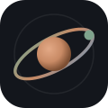

<p align="center">
  
</p>

# 🛰️ Project ORBITA — 3D Orbital Command & Voice Satellite Inspector


> **Live App:** **[orbitaproject1.vercel.app](https://orbitaproject1.vercel.app)**  
> **Project ORBITA** is an interactive, distraction-free 3D satellite tracking and orbital intelligence command center built with a matte dark Claymorphism UI, SGP4 orbital mechanics, live OSINT feeds, and a two-way conversational Voice AI assistant.

---

## 🖥️ How ORBITA Works (Interface Overview)

- **Clean Space Canvas:** Opens directly to a photorealistic 3D Earth with real continents, 8 active Ground Stations (ISRO, NASA, ESA, JAXA), and 135+ 3D solar-winged satellites orbiting in real time—with zero screen clutter.
- **Collapsible Side Clay Icon Dock:** All controls stay neatly tucked into 5 tactile icons on the left (`🛰️`, `📡`, `🌐`, `💬`, `⌨️`). Click any icon to open its drawer, and click again (or press `Esc`) to close it.

---

## 🧭 Step-by-Step User Guide

### 1. Filter & Search Satellites (`🛰️` Icon)
- Click the top **`🛰️` (All Satellites & Telemetry)** icon on the left dock.
- Use the **Category Filter Tabs** (`ALL`, `ISRO`, `STARLINK`, `GPS`) to isolate specific constellations both in the list and on the 3D globe.
- Or type any satellite name or NORAD ID (e.g., `CARTOSAT`, `NAVIC`, `STARLINK`) in the **Search Box** to find it instantly.

### 2. Select a Satellite & Track Live Location
- **Click any 3D satellite** directly on the rotating globe, or select it from the drawer list.
- Its **90-minute orbital trajectory** highlights around the Earth, and if it is within range of a ground station (such as *ISTRAC Bengaluru* or *SDSC Sriharikota*), a green **RF Telemetry Link** connects them.
- The live telemetry card immediately updates with:
  - **Overhead Country / Ocean** (real-time reverse geocoding)
  - **Altitude (km)** & **Orbital Velocity (km/s)**
  - **Exact Latitude & Longitude**

### 3. Inspect in 3D Close-Up with `VIEW MAX` (`M`)
- With any satellite selected, click **`⛶ VIEW MAX (3D INSPECT)`** (or press **`M`** on your keyboard).
- The camera smoothly flies right up to the 3D spacecraft in orbit and opens the **Satellite Intelligence Dossier**, showing its **NORAD ID**, **Operating Agency**, **Orbit Class**, **Inclination**, **Overhead Region**, and **Full Payload & Mission Capabilities**.

### 4. Talk to ORBITA Voice AI (`🎙️ Talk [V]`)
- Click **`🎙️ Talk [V]`** at the bottom-left (or open the **`💬`** chat drawer to type) and give natural commands:
  - *"Show all ISRO satellites"*
  - *"Where is ISS right now?"*
  - *"India dikhao"*
  - *"View Max"*
  - *"Show earthquakes"* or *"Show India flights"*

---

## 📁 Project Files

```text
ORBITA_Project/
├── index.html      # Modular HUD & collapsible Clay drawer layout
├── style.css       # Matte dark Claymorphism & deep space styling
├── app.js          # Three.js globe, SGP4 orbital mechanics, Voice AI & OSINT
├── logo.svg        # Custom vector emblem & browser favicon
├── vercel.json     # Vercel production routing configuration
└── README.md       # Project documentation & user guide